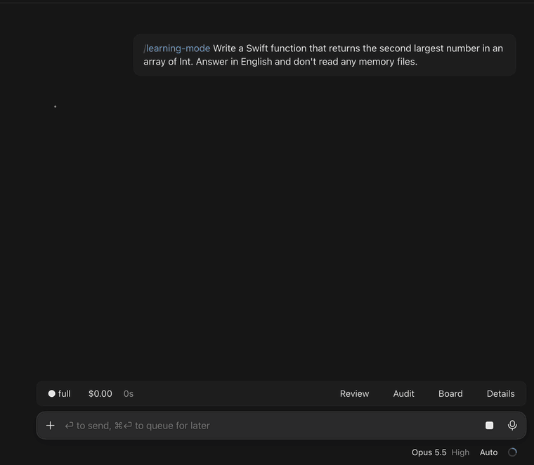

# learning-mode

**A Claude Code skill that turns Claude into a tutor who teaches instead of doing your homework.**

It explains the theory with examples on *different* material, gives you a detailed step-by-step task, checks your solution like a strict but kind reviewer, and only writes the final answer if you explicitly ask for it.



## Why I made this

A lot of studying today means teaching yourself. Nobody hands you the knowledge on a plate, and it's easy to lose motivation, ask an AI for the solution, paste it in and move on. Then comes the moment you have to explain or defend that code, and you realize you don't understand a single line of it.

For me, the point of studying has always been to actually learn something, not just to get it done. I didn't want AI to make me lazier; I wanted it to keep me sharp. So I wanted the opposite: to use AI to actually *understand* the material. To know my code well enough to spot its holes myself, from a missed edge case to an API key left in plain sight, before someone else finds them.

And I was tired of explaining in every new chat how I want to be taught. So I wrote it down once, as a skill. Now every chat starts as a tutor, not as an answer machine.

## What it looks like

You ask: *"Write a Swift function that returns the second largest number in an array."*

**Without the skill**, you get a finished function. You copy it and learn nothing.

**With the skill**, you get:

1. **What needs to be done**: the requirements in plain words and the idea behind them.
2. **Theory in steps**: Optionals ("a box that may be empty"), walking an array while keeping state, shown on a *different* example (finding the shortest string), with every piece of syntax explained.
3. **Your task**: a detailed list of what to write and where, which idea to apply, and which edge cases to test (`[]`, `[1]`, `[5, 5, 3]`).
4. **A question to think about**: *what changes if you need the k-th largest?*

Then you write the code yourself, send it back, and get a review: a verdict, each mistake explained through a scenario where it breaks, and a hint instead of a fix.

## Rules it follows

- **One stage at a time.** The next stage starts only when the current one works.
- **Examples never match your task.** Same idea, different data, so nothing can be copied by renaming variables.
- **No fill-in-the-blank templates.** `return items.first(where: { ___ })` is still the answer.
- **"I don't understand" is not "solve it for me".** It gets new examples and a line-by-line trace of *your* code.
- **The full solution only on explicit request**: "give me the solution", "solve it for me".

## Install

In Claude Code, run:

```
/plugin install learning-mode --marketplace wmeenw/learning-mode
```

The skill activates automatically when you share an assignment or ask to explain a topic.

<details>
<summary>Manual install (copy the skill folder)</summary>

```bash
git clone https://github.com/wmeenw/learning-mode.git
```

```bash
mkdir -p ~/.claude/skills && cp -r learning-mode/skills/learning-mode ~/.claude/skills/
```

Then restart Claude Code.
</details>

## Customize

Everything lives in one file: [`skills/learning-mode/SKILL.md`](skills/learning-mode/SKILL.md). Change the answer template, add sections for your language or IDE, or tune what counts as "a ready-made solution".

## License

[MIT](LICENSE)
